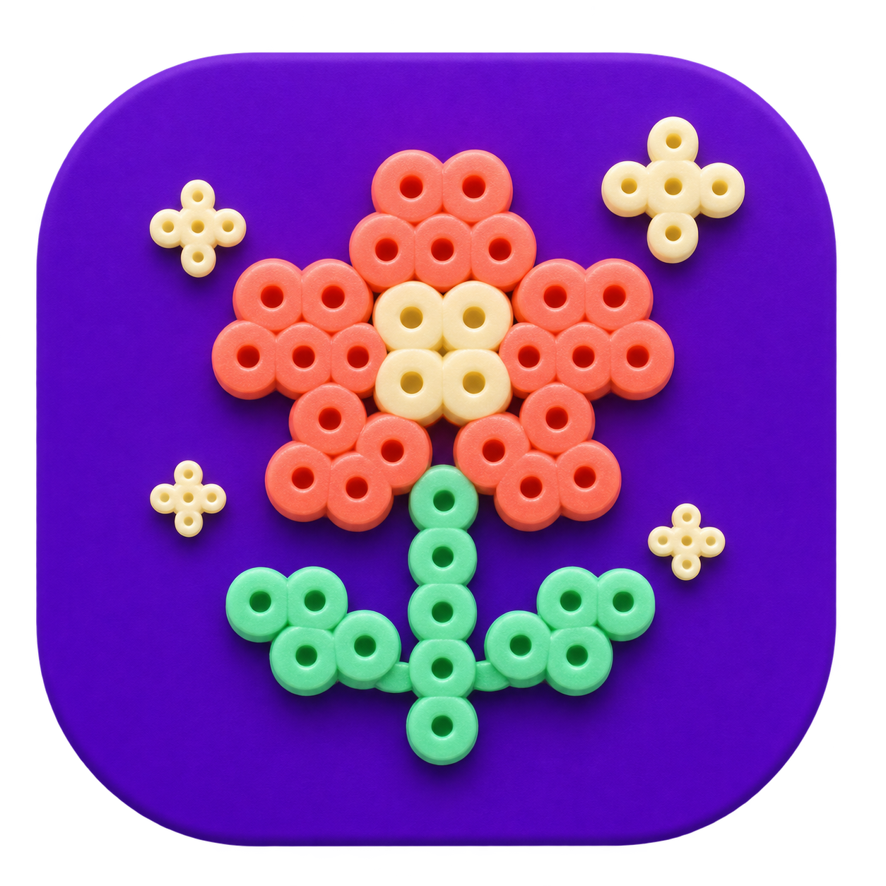
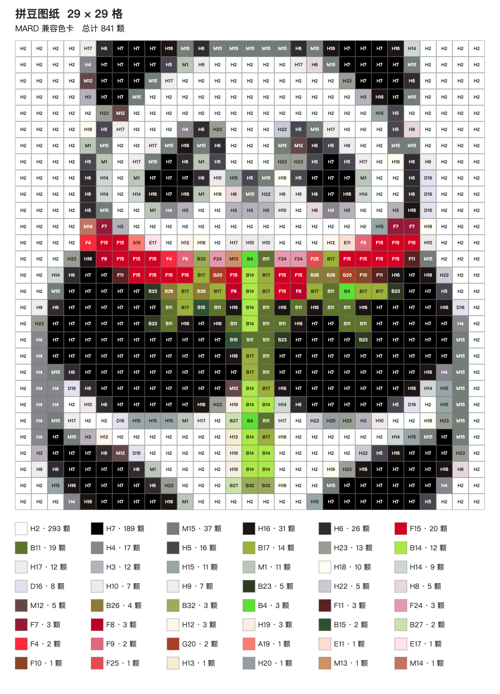

# AI 拼豆图纸制作

把喜欢的图片，或脑海里的一个想法，变成可以照着摆豆的图纸。

打开应用后选择一种方式：**“我有想拼的图片”**，直接上传图片制作；或 **“用AI帮我生图”**，使用自己的生图服务生成候选图。选好画面后，调整裁切范围，一键生成带色号和用量清单的拼豆图纸，并保存为 PNG 图片。

## 下载和安装

**适用设备：** Apple 芯片（M1、M2、M3 等）的 Mac，macOS 12 或更高版本。目前不支持 Intel Mac 和 Windows。

1. [点击下载 Mac 版](https://github.com/Vincent-chk/ai-bead-pattern/releases/download/v0.1.0-beta.3/AI-Bead-Pattern-macOS-arm64.zip)。
2. 双击下载的 ZIP 文件解压。
3. 打开解压后的文件夹，双击 **“AI拼豆图纸.app”**，等待浏览器自动打开。

其他版本可在 [GitHub Releases](https://github.com/Vincent-chk/ai-bead-pattern/releases) 查看。

不需要安装编程软件或自行部署网站。如果打开的是旧版本，请先退出旧版本，再打开新版；已保存的本机模型设置可以继续使用。

**首次打开遇到系统提示？** 由于应用尚未经过 Apple 公证，macOS 可能阻止启动。确认下载来源是本项目后，在 Mac 的 **“系统设置 → 隐私与安全性”** 中查看提示并选择允许打开。无需关闭系统的全局安全保护。

应用运行时会出现在 Dock。使用完毕后，在应用菜单中选择“退出 AI拼豆图纸”，或按 **Command-Q**；仅关闭浏览器标签页不会退出应用。再次点击 Dock 图标可以重新打开页面。

## 用自己的图片制作图纸

上传图片制作图纸不需要联网，也不需要 API Key。

1. 打开应用，点击 **“我有想拼的图片”**，再点击 **“上传图片”** 选择本机图片。
2. 选择图纸尺寸：**29 × 29、52 × 52 或 104 × 104 格**。每格代表一颗豆或一个空位。
3. 在“裁切图片”区域拖动画框，或使用滑块移动和缩放图片。右侧预览显示选中的画面；裁切框始终是正方形，框外的内容会被裁掉。
4. 点击 **“生成图纸”**，查看每一格的色号和用量清单。
5. 点击 **“下载 PNG”**，把图纸保存到电脑。需要看清细节时，可以用“图纸缩放”放大查看。

图纸使用 **MARD 兼容色卡**。屏幕颜色与实物可能有差异，建议制作前对照手中的豆子。图片中的不透明白底会保留并匹配颜色；如果希望背景留空，请使用透明背景图片。生成后暂不支持逐格修改，可以重新裁切并生成。

## 用 AI 把想法变成图纸

在首页选择 **“用AI帮我生图”**，进入独立的 AI 生图流程。该功能需要联网，并使用你自己的生图服务 API Key，可能产生服务商费用。上传已有图片制作图纸不需要这些设置。

### 先设置生图服务

1. 进入 AI 生图后，在 **“模型设置”** 中选择服务。
2. 填写服务地址、模型名称和 API Key，然后点击 **“保存设置”**。请使用你自己已开通的服务及模型对应的信息。
3. 如果使用火山方舟，可以选择 **Seedream**；也可以选择 OpenAI 或提供兼容图片接口的服务。不同服务和模型支持的功能可能不同。

例如，本项目已使用火山方舟 **Agent Plan** 验证文字生图和参考图修改，设置为：

- 服务：`Seedream`
- 服务地址：`https://ark.cn-beijing.volces.com/api/plan/v3/images/generations`
- 模型名称：`doubao-seedream-5.0-flash`
- API Key：填写你自己的 Agent Plan 密钥

如果你的账户使用其他服务或模型，请以相应平台提供的地址、模型名及权限为准。API Key 保存在本机配置文件中，可在模型设置中更换或清除，不要发给他人。

### 生成并挑选画面

1. 在 **“描述你的想法”** 中输入画面，例如“一只戴着草莓帽的小猫，柔和配色”。
2. 点击 **“生成候选图”**，等待结果。每次会尝试生成三张，实际数量取决于服务返回结果。
3. 点击喜欢的候选图，再点击 **“使用此图”**，进入裁切并生成图纸。
4. 如果想继续修改，选中候选图，在 **“补充修改要求”** 中描述变化，再点击 **“参考此图生成”**。这需要所选服务和模型支持参考图修改；也可以重新生成候选图。

提示词会发送给你选择的生图服务；使用参考图继续生成时，选中的图片也会发送给该服务。每次生成或重新生成都可能产生费用，具体以服务商计费为准。

## 常见问题

**不想用 AI，可以只上传图片吗？**  可以。上传、裁切、图纸转换和导出都在本机完成。

**为什么图纸有很多不同色号？**  程序会根据画面中每格的平均颜色匹配色卡，不会自动合并相近色号。选择轮廓清楚、颜色简单的图片，通常更容易制作。

**为什么生成失败？**  请先检查网络、API Key、服务地址和模型名称，并确认账户已开通相应模型。参考图修改还需要模型支持该功能。页面会显示错误提示。

**上传图片为什么提示过大？**  请先将图片缩小到 1600 万像素以内，并确保最长边不超过 8192 像素，再上传。

**是否支持其他品牌色卡或手动改单格颜色？**  当前版本提供 MARD 兼容色卡，暂不支持逐格修改或切换到其他品牌色卡。

## 开源与说明

本项目基于 [Bead Grid Studio](https://github.com/zwhy149/bead-grid-studio) 改造，遵循 [Apache-2.0 许可证](LICENSE)；MARD 兼容色卡数据及其他来源说明见 [NOTICE](NOTICE)。色卡兼容不代表品牌官方认证或授权。

当前为测试版，已在 Apple 芯片 Mac 上验证本地转换和导出，尚未在另一台干净的 Mac 上验证首次打开体验。其他生图服务和模型的可用性取决于其接口及账户权限。
