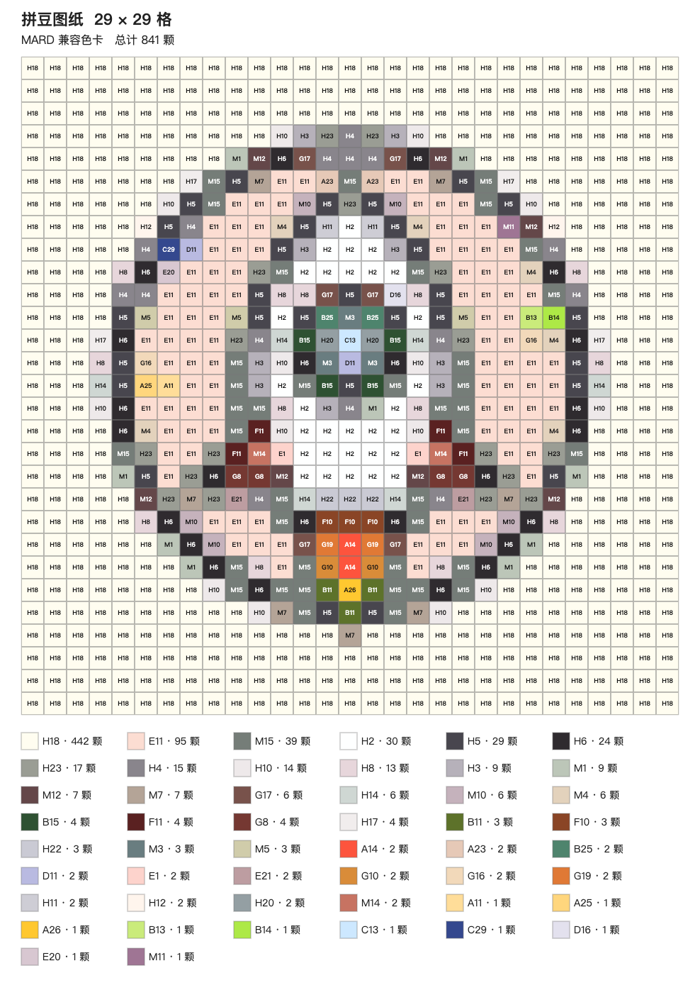

# AI 拼豆图纸制作

把自己的图片转换成带色号和材料数量的拼豆图纸，也可以配置在线生图服务，把文字想法变成候选图片后制作图纸。界面使用中文，图纸转换在本机完成。

**验证状态：** 已在 Apple 芯片 Mac 上使用最终 ZIP 验证解压启动、离线上传图片转换并导出 PNG，以及退出应用。尚未在另一台干净的 Mac 上验证。真实 Seedream 生图因测试凭证没有所需权限尚未通过；其他在线服务也尚未完成真实调用验证。当前提供预发行测试版。

## 下载和启动

从 [GitHub Releases](https://github.com/Vincent-chk/ai-bead-pattern/releases) 下载面向 Apple 芯片 Mac 的 `AI-Bead-Pattern-macOS-arm64.zip` 并解压，双击“AI拼豆图纸.app”，等待浏览器打开。运行包包含所需 Node.js，使用者无需自行安装 Node.js 或 Python。Intel Mac 和 Windows 不在首版支持范围内。

构建脚本生成的应用未使用 Developer ID 签名，也未经 Apple 公证。首次打开时 macOS 可能阻止运行；确认下载来源可信后，在“系统设置 → 隐私与安全性”中查看提示并选择允许。应用运行时显示在 Dock；使用菜单栏退出或按 Command-Q 可关闭应用和本地服务，仅关闭浏览器标签不会退出应用。尚未在独立的干净 Mac 上验证首次启动体验。

## 制作图纸

1. 选择 29 × 29、52 × 52 或 104 × 104 格；每格代表一颗豆或一个空位。图纸使用 MARD 兼容色卡。
2. 上传本机图片；或者配置生图服务后输入想法，生成约三张候选图。候选数量以实际成功结果为准，也可以重新生成。选中候选图并填写补充要求，可以尝试基于该图继续生成，前提是所选服务和模型支持参考图。
3. 移动或缩放正方形裁切框，选出需要的画面。图片保持原有比例，框外内容会被裁掉。
4. 生成图纸后查看逐格色号和用量，放大检查，再导出 PNG。图纸不提供逐格编辑。

透明部分按格子的可见覆盖率处理：不足 50% 留空，达到 50% 则匹配颜色；不透明白色背景会保留，不会自动抠图。如需背景留空，请准备透明背景图片。

**本地上传样例：** 下图使用上游项目的样图，通过本机上传、转换并导出，并非 Seedream 生成。



## 在线生图与隐私

上传图片、裁切、转换和导出在本机处理，不需要账号、API Key 或互联网。在线生图需要联网，并使用你自己的服务 API Key；在设置中可更换或清除密钥。密钥保存在本机的应用配置中，请勿提交到代码仓库或通过聊天发送给他人。

默认推荐火山方舟 Seedream，也可配置 OpenAI 图片接口或其他提供相应兼容接口的服务地址与模型。文生图和参考图编辑是不同能力，自定义地址不代表所有服务或模型均兼容。真实 Seedream 调用因测试凭证没有所需权限尚未通过，其他服务尚未完成真实调用验证；实际可用性以对应服务的接口、模型权限和后续验证结果为准。调用时提示词会发送给所选服务；使用参考图继续生成时，所选图片也会发送给该服务。请查看服务商的数据处理条款。

在线生图可能产生服务商费用，由你自己的账户承担。每次请求约三张候选图，具体计费和实际返回数量由服务及模型决定；重新生成或参考图生成也可能再次计费。上传图片的本地转换不收取模型调用费用。

## 色卡与开源许可

本项目使用 MARD 兼容色卡数据，来源及 MIT 许可见 [NOTICE](NOTICE)。兼容不代表厂商官方认证、授权或背书；屏幕颜色仅供参考，制作前请以所用品牌和批次的实物色卡核对。

本项目基于 [Bead Grid Studio](https://github.com/zwhy149/bead-grid-studio) 改造，保留上游版权和 Apache-2.0 许可，见 [LICENSE](LICENSE) 与 [NOTICE](NOTICE)。本项目围绕中文本地使用流程增加了文字生图配置、候选与参考图流程、正方形裁切、固定尺寸和图纸转换，以及 Apple 芯片 Mac 启动和打包方式；具体行为和交付状态以代码及验收结果为准。第三方运行时和资源的许可随适用文件或运行包提供。

## 开发

需要 Node.js 22.12.0 或更高版本。安装依赖并构建：

```sh
npm ci
npm run build
```

Apple 芯片 Mac 上执行 `scripts/pack-macos.sh` 可构建运行包。脚本会获取并校验指定 Node.js 运行时；构建、签名和发布前应检查输出与许可，并在目标环境验证完整流程。
